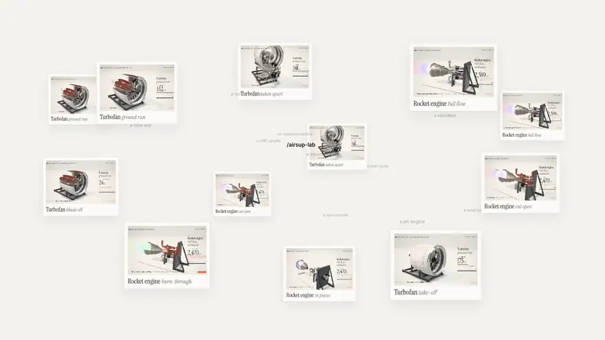
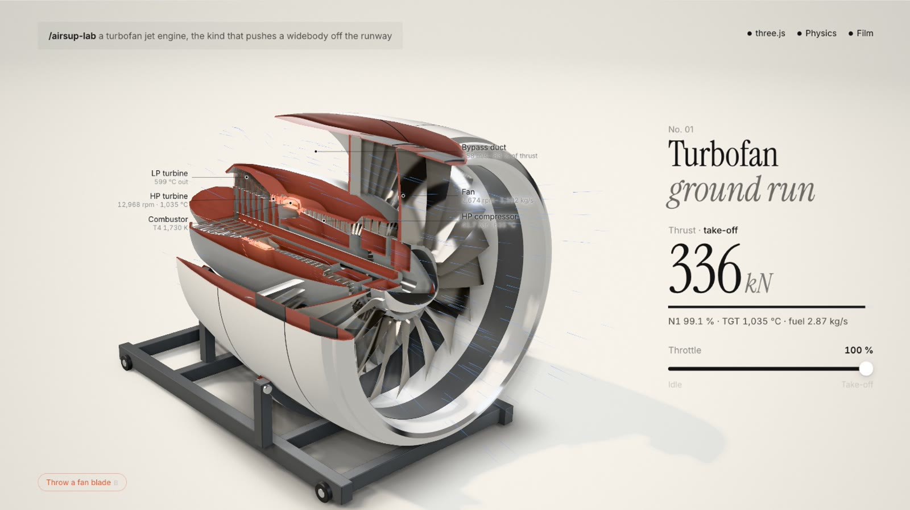
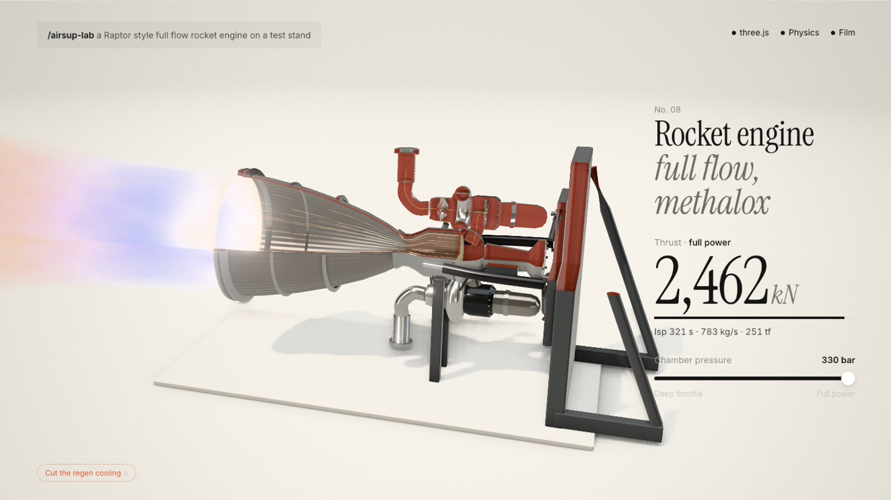
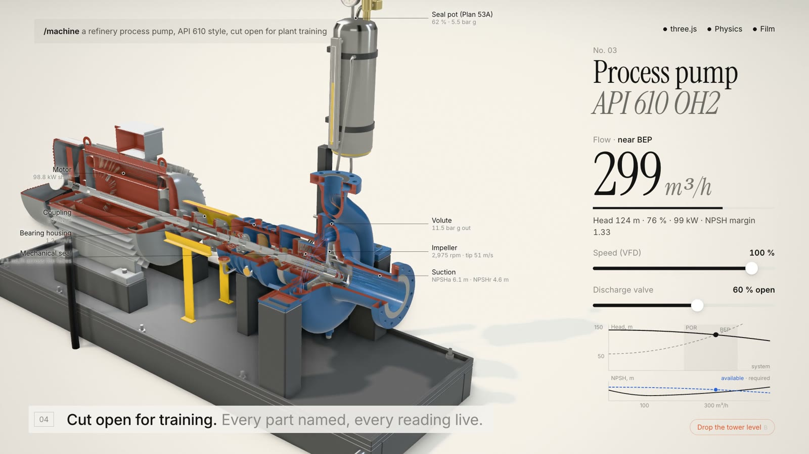
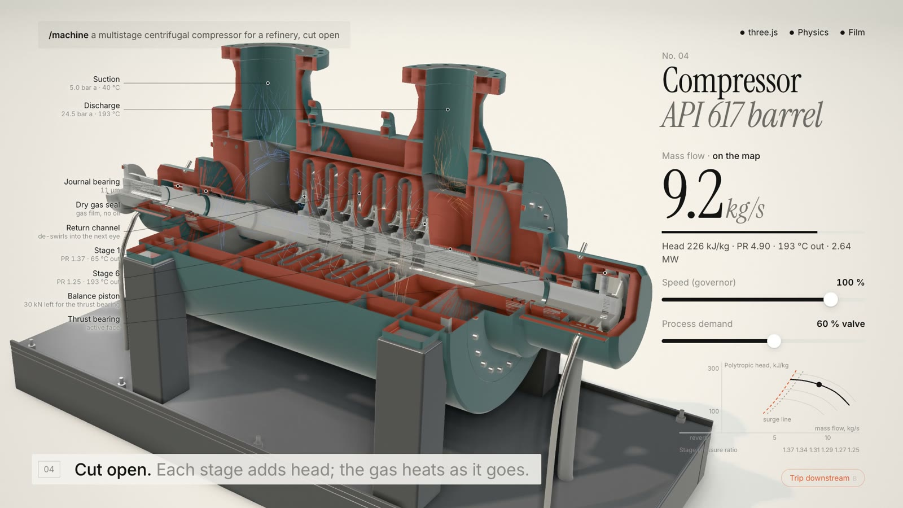

<h1 align="center">Machine Skill</h1>

<p align="center"><b>Describe any machine in one line. Claude builds the real thing, running on real physics.</b><br>A photoreal, interactive 3D simulation in one HTML file, plus the film to post it. An open source skill for Claude Code.</p>

<p align="center">
  <a href="https://code.claude.com/docs/en/skills"></a>
  <a href="https://agentskills.io"></a>
  <a href="LICENSE"></a>
  <a href="#requirements"></a>
  <a href="#requirements"></a>
</p>

<p align="center">
  <a href="https://airsup.ai/lab/skill"></a>
  &nbsp;
  <a href="#install"></a>
</p>

<p align="center">
  <a href="https://airsup.ai/lab/skill"></a>
</p>

<p align="center"><sub>Every frame above is three.js in a browser, recorded with this repo's own <code>scripts/record.mjs</code>. Every number on screen is computed.</sub></p>

---

```text
/machine a turbofan jet engine, the kind that pushes a widebody off the runway
```

Claude researches the real machine, writes down its real dimensions and the physics that make it work, and builds it: a 2.9 m fan of twisted titanium airfoils, a 10 stage compressor, an annular combustor with 22 fuel nozzles, two turbines glowing at the temperatures a Brayton cycle solver computes, on a ground run stand. You drag the throttle and about 340 kN comes out of the cycle, not out of a table. You cut it open and the section faces are solid metal. You throw a fan blade and the solver tells you the imbalance load the case has to hold.

Then one command turns it into a film for your feed.

## Quick start

```sh
npx skills add AirsupHQ/machine-skill -g -a claude-code
```

Then in Claude Code:

```text
/machine a mechanical watch movement, the escapement ticking
```

You get `watch.html`: open it, drag, cut, explode, break. To film it:

```sh
node ~/.claude/skills/machine/scripts/record.mjs watch.html out/watch.mp4 --music freepd:Classical/Easy_Lemon
```

## Gallery

Each machine was made from the single line under it. Click one to run it live.

<table>
  <tr>
    <td width="50%"><a href="https://airsup.ai/lab/skill/turbofan"></a></td>
    <td width="50%"><a href="https://airsup.ai/lab/skill/rocket-engine"></a></td>
  </tr>
  <tr>
    <td><sub><b>Turbofan</b> · <i>a turbofan jet engine, the kind that pushes a widebody off the runway</i><br>Brayton cycle: about 340 kN at take-off, 83 % of it from the bypass. 3,597 parts. Break: throw a fan blade, and the solver computes the load the case must hold.</sub></td>
    <td><sub><b>Rocket engine</b> · <i>a Raptor style full flow rocket engine on a test stand</i><br>Chamber and nozzle solution: 2,462 kN and Isp 321 s at 330 bar, sea level, Mach 4.06 at the exit. Break: cut the regen cooling and the copper throat melts.</sub></td>
  </tr>
  <tr>
    <td width="50%"><a href="https://airsup.ai/lab/skill/refinery-pump"></a></td>
    <td width="50%"><a href="https://airsup.ai/lab/skill/compressor"></a></td>
  </tr>
  <tr>
    <td><sub><b>Process pump</b> · <i>a refinery process pump, API 610 style, cut open for plant training</i><br>Pump curve with the affinity laws, BEP, NPSH available against required, seal face leakage. Hover any part for what it does and what the operator checks. Break: drop the tower level and it cavitates.</sub></td>
    <td><sub><b>Compressor</b> · <i>a multistage centrifugal compressor for a refinery, cut open</i><br>Six stages on one map: polytropic head, stage pressure ratios, surge line, anti-surge control, a lumped surge model. Break: trip the downstream unit with the anti-surge valve stuck and it surges.</sub></td>
  </tr>
</table>

The pages are in [`examples/`](examples): each is one HTML file you can open from disk. More machines are coming; see [V2-IDEAS.md](V2-IDEAS.md), and send yours as a pull request.

## What you get

| | |
|---|---|
| **The real machine** | Real proportions in metres, 15 to 40 named parts and thousands of solid pieces (blades, teeth, bolts), lathe turned solids, cambered and twisted airfoils, involute gears, routed pipes. A scale bar shows real size. |
| **Real materials** | Physically based steel, titanium, Inconel, copper, brass, aluminium, paints, polymers, glass and sapphire, with measured reflectances, micro finishes (turned, brushed, cast), clearcoats and heat glow from the solver's temperatures. |
| **A studio** | A softbox environment with black flags, a soft key shadow, contact shadow, ambient occlusion, bloom, a paper seamless or a night set. It looks like a product photograph before it moves. |
| **Real physics** | A small solver per machine (Brayton cycle, rocket chamber and nozzle, slider crank and BMEP, torsional oscillator, Cp(lambda, beta), pump curves, Kienzle, Darcy) drives every motion and every number. "How it is computed" shows the equations. |
| **Modes** | Explode, cutaway with solid section faces, x-ray, slow motion, live labels, pause, and a computed "break it". |
| **A film** | `?film=1` gives a deterministic clock. One command records a 28 s film in numbered beats: you type one line, Claude builds it part by part, it runs, it opens, it comes apart, it breaks. Music bed included, magenta frame guard and pink scan built in. |

## Install

Machine Skill is a standard [Agent Skill](https://code.claude.com/docs/en/skills): a folder with a `SKILL.md` at its root. This repository is that folder.

| | Command | Installs to |
|---|---|---|
| **skills CLI**, for you | `npx skills add AirsupHQ/machine-skill -g -a claude-code` | `~/.claude/skills/machine` |
| **skills CLI**, one project | `npx skills add AirsupHQ/machine-skill` | `.claude/skills/machine` |
| **git**, for you | `git clone https://github.com/AirsupHQ/machine-skill.git ~/.claude/skills/machine` | `~/.claude/skills/machine` |
| **git**, one project | `git clone https://github.com/AirsupHQ/machine-skill.git .claude/skills/machine` | `.claude/skills/machine` |

Claude Code picks up new skills in a running session; if the `skills` folder did not exist when the session started, run `/reload-skills`.

<details>
<summary><b>Other agent hosts</b></summary>

<br>

- **Claude.ai and the Claude desktop app**: zip this folder and upload it under Settings, Capabilities, Skills. The pages run in any browser; recording needs a machine with Node and ffmpeg.
- **Claude Agent SDK / API with skills**: mount the folder as a skill directory; SKILL.md is self contained.
- **Codex, Cursor, other agents that read Agent Skills**: point them at `SKILL.md`. Everything else is plain files.
- **No agent at all**: copy `kit/template.html`, fill the four sections by hand.

</details>

## Usage

Type `/machine` and name the machine. You can also just ask Claude to "build", "simulate" or "show how X works"; the skill loads itself for machines, engines, mechanisms and devices.

```text
/machine a hydroelectric Francis turbine
/machine a Swiss lever escapement, slowed down so I can see the impulse
/machine the gearbox of a 5 MW wind turbine, cut open
/machine a steam locomotive's valve gear, and give me a 30 second video for X
```

Three habits get the best machines:

1. **Name the real thing.** "A turbofan like the ones on a 787" beats "a jet engine": Claude looks up the real dimensions and operating point.
2. **Say what should move and what should break.** "Rev it until the valves float" tells the solver what to compute.
3. **Say where it goes.** A page to embed, a film for X (1080 x 1080 or 1080 x 1350 with `--w`/`--h`), or a still for a slide.

## Record a film

```sh
node scripts/record.mjs examples/turbofan.html out/turbofan.mp4 --music freepd:Classical/Easy_Lemon
node scripts/record.mjs examples/turbofan.html out/turbofan-feed.mp4 --w 1080 --h 1350
node scripts/record.mjs examples/turbofan.html out/stills --stills 3,9,14,19
node scripts/pinkscan.mjs out/*.mp4
```

The page runs with `?film=1&shot=main`: time only moves when the recorder steps it, so every frame is fully rendered and a take is identical every time. `--ss 1.5` supersamples, `--blur 2` adds motion blur, `--fps 60` for very fast motion. Music: any file, URL, or `freepd:<Category>/<Name>` (CC0 tracks from [FreePD](https://freepd.com) via archive.org). The recorder guards every screenshot against the solid magenta frames a stalled headless GPU can return and scans the finished film; it exits non zero if a pink frame got through.

The launch film at the top was directed in a browser page, [`film/launch.html`](film/launch.html), that embeds a live machine page and steps it frame by frame.

## How it works

- **[`SKILL.md`](SKILL.md)** is what Claude reads: the bar a result must clear, the workflow (research, geometry, materials, solver, effects, modes, four critic rounds, the film), and the writing style on screen.
- **[`kit/lab-kit.js`](kit/lab-kit.js)** is the runtime every page inlines (one ES module, no build step, three.js 0.170 from a pinned CDN). Studio, post stack, material library with section caps, geometry builders, explode, cutaway, x-ray, labels, flow streaks, plumes, sparks, rigid debris, the editorial layer and the film timeline.
- **[`references/solvers.md`](references/solvers.md)** holds solver recipes with real constants for gas turbines, rockets, piston engines, watches, rotors, pumps, machine tools, porous flow and electric machines.
- **[`scripts/`](scripts)**: `shot.mjs` (screenshots for the critic rounds, prints fps, parts and triangles), `record.mjs` (films), `pinkscan.mjs`, `inline.mjs` (paste the kit into a page).

<details>
<summary><b>The cutaway, in one paragraph</b></summary>

<br>

Every part is a closed solid with a double sided material clipped by two planes (a half or a quarter section). Where the planes open a solid, the camera sees that solid's back faces; the material's shader recognises them by casting the view ray against both planes, and draws them as the section face instead: plane normal, plane depth (written to the depth buffer so it occludes correctly), a freshly machined colour of the same material and a faint hatch. No cap geometry, any cut position, so the cut can sweep in live.

</details>

<details>
<summary><b>Repository layout</b></summary>

<br>

```text
machine-skill/
├── SKILL.md                 what Claude reads
├── kit/
│   ├── lab-kit.js           the runtime (inlined into every page)
│   └── template.html        the page Claude starts from
├── references/solvers.md    physics recipes with real constants
├── scripts/                 shot, record, pinkscan, inline (+ lib: server, browser, guard, png)
├── examples/                the example machines, one HTML file each, and their posters
├── film/launch.html         the launch film director page
└── evals/evals.json         prompts and what a good answer contains
```

</details>

## Requirements

| | Needed for | Notes |
|---|---|---|
| **Claude Code** (or any Agent Skills host) | building machines | |
| **A browser with WebGL 2** | running the pages | Desktop Chrome, Safari, Firefox, Edge. Phones work with a lighter load. |
| **Node 18+, Playwright, ffmpeg** | screenshots and films | `npm i -D playwright && npx playwright install chromium`; ffmpeg from your package manager. |

## Limits

- **It builds machines.** Mechanisms, engines, instruments, devices. People, landscapes and maps come out weaker.
- **The physics is a small honest model, not CFD or FEA.** Each page says what it computes and what it simplifies. Numbers are checked against public figures, not certified.
- **Real parts, not a CAD export.** Geometry is procedural three.js; it is accurate in proportion and part count, not to manufacturing tolerance.
- **Heavy pages want a real GPU.** About 600k triangles with shadows, AO and bloom runs at 60 fps on a recent laptop.

## Siblings and credits

- **[Factory skill](https://airsup.ai/lab/factory-skill)**: the same idea for whole factories. Describe a line in one sentence and Claude builds it as a live discrete event simulation.
- **[Anatomy](https://github.com/wheresryan22/anatomy)** by Ryan (@wheresryan22) showed how good a one line machine skill can be. Its numbered beat film inspired ours.
- **[airsup.ai/lab](https://airsup.ai/lab)** is where these machines come from: more than 50 simulations built with Claude Opus 5.5.
- three.js (MIT), Instrument Serif, Inter and JetBrains Mono (OFL), music from FreePD (CC0).

## License

[MIT](LICENSE) © 2026 Airsup · [airsup.ai/lab](https://airsup.ai/lab)
